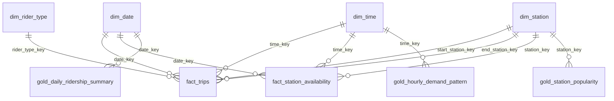

# Citi Bike Medallion Pipeline

Semester project — end-to-end Spark data pipeline (Bronze → Silver → Gold) for NYC Citi Bike trip data, culminating in a Power BI dashboard.

## Team

- Muhammad Abdullah 22L7545
- Shaheer Asif 22L6396

## Project Summary

This project builds an automated Medallion Architecture pipeline on Apache Spark (Databricks Free Edition) using NYC Citi Bike's public trip-history data. See `docs/Phase1_Project_Proposal.docx` for the full Phase 1 proposal, covering domain selection, data volume estimates, PII analysis, the Bronze/Silver/Gold modeling plan, and the BI dashboard design.

## Repository Structure

```
├── data/
│   ├── samples/          # Trimmed sample files (full-load + incremental + GBFS) committed to the repo
│   ├── raw/              # Full downloaded trip-history files (gitignored -- not committed)
│   ├── gbfs/             # Accumulated hourly GBFS station-status snapshots (gitignored -- not committed)
│   └── manifest.json     # Tracks which months are already in the baseline, so re-runs fetch new months only
├── notebooks/            # Databricks / Jupyter notebooks for Bronze, Silver, Gold processing
├── scripts/
│   ├── fetch_samples.py  # Downloads recent monthly trip data from Citi Bike's S3 bucket; builds baseline + incremental
│   └── poll_gbfs.py      # Polls the live GBFS station-status feed hourly and appends a snapshot
├── docs/                 # Project proposal and supporting documentation
└── README.md
```

## Data Sources

- **Full load:** the most recent 6 complete months of Citi Bike trip data at the time the pipeline is first run (auto-detected by `fetch_samples.py` — never a fixed past year, so the baseline is always "recent history")
  (`https://s3.amazonaws.com/tripdata/<YYYYMM>-citibike-tripdata.csv.zip` or `.zip`, depending on which the source uses for that month)
- **Incremental load:** whichever new month Citi Bike publishes after the baseline was set. `fetch_samples.py` tracks this via `data/manifest.json` and only pulls the next unseen month, so re-running it monthly ingests genuinely new data rather than replaying old months.
- **Live incremental stream:** Citi Bike's GBFS `station_status` feed, polled hourly by `scripts/poll_gbfs.py`, giving real time-varying data (bikes/docks available per station) independent of the monthly trip-history release cycle.

## Getting the Data

The full raw files are too large to commit to GitHub, so only trimmed samples live in `data/samples/`.

**Monthly trip data (full load, then incremental on each re-run):**
```bash
pip install requests
python scripts/fetch_samples.py
```
First run: downloads the 6 most recent complete months into `data/raw/full_load/` and records them in `data/manifest.json`.
Later runs (e.g., once a month): downloads only the next newly published month into `data/raw/incremental/` and updates the manifest.

**Live GBFS station status (run hourly):**
```bash
python scripts/poll_gbfs.py
```
Appends one row per station to `data/gbfs/station_status_history.csv`. See the scheduling notes at the bottom of that file for setting it up as an hourly Windows Task Scheduler job or cron job so it accumulates real data over several days.

## Pipeline Layers

| Layer | Purpose |
|---|---|
| Bronze | Raw trip records as ingested, partitioned by year/month, with ingestion metadata |
| Silver | Cleansed, typed, deduplicated `silver_trips` fact table + `silver_stations` reference table |
| Gold | Star schema (`fact_trips`, `dim_station`, `dim_date`, `dim_time`, `dim_rider_type`) and aggregate tables for BI |

## Dashboard

Built in Power BI on top of the Gold layer. See `docs/Phase1_Project_Proposal.docx`, Section 5, for the full dashboard outline and business questions.

## Infrastructure & Cost Management

Developed on Databricks Free Edition, with Azure for Students as a fallback. See `docs/Phase1_Project_Proposal.docx`, Section 6, for the FinOps plan.

## Hourly GBFS polling (Windows)

1. Find your Python path: `where python`
2. Register the hourly task (replace both paths with your own):

```
schtasks /create /sc hourly /tn "CitiBikeGBFSPoll" /tr "\"C:\path\to\python.exe\" \"C:\path\to\repo\scripts\poll_gbfs.py\"" /st 00:00
```

3. Check it exists: `schtasks /query /tn "CitiBikeGBFSPoll"`
4. Remove it when no longer needed: `schtasks /delete /tn "CitiBikeGBFSPoll" /f`

The laptop must be powered on and awake for the task to run; polls missed while asleep are simply skipped.


---

# Phase 2 — Core Pipeline (Bronze & Silver)

PySpark pipeline on **Databricks Free Edition (serverless)**. Delta tables live in Unity Catalog, catalog `workspace`, schemas `citibike_raw` (landing volume), `citibike_bronze`, `citibike_silver`, `citibike_ops`.

```
 laptop ──upload──▶ Volume landing/             Bronze (strings + lineage)         Silver (typed, validated)
 fetch_samples.py     trips/<YYYYMM>/*.csv ──▶  bronze_trips ───────────────────▶   silver_trips ──▶ silver_stations
 poll_gbfs.py         gbfs/*.csv           ──▶  bronze_gbfs_station_status ─────▶   silver_gbfs_station_status
                                                                                    quarantine_records (bad rows + reason)
                       every step of every layer ──▶ citibike_ops.pipeline_execution_logs
```

## Repository layout

| Path | Purpose |
|---|---|
| `notebooks/00_setup.py` | Creates schemas, landing volume and every table with explicit column types (safe to re-run) |
| `notebooks/01_common.py` | Shared library loaded by the others with `%run`: schema contracts, drift handling, Silver rules, `MERGE` helper, audit logger |
| `notebooks/02_raw_to_bronze_trips.py` | **Raw → Bronze** for trips (parameterized) |
| `notebooks/03_bronze_to_silver_trips.py` | **Bronze → Silver** for trips, stations and quarantine (parameterized) |
| `notebooks/04_gbfs_raw_to_bronze.py` | Raw → Bronze for the live GBFS feed |
| `notebooks/05_gbfs_bronze_to_silver.py` | Bronze → Silver for GBFS (date-range parameters) |
| `notebooks/90_demo_proof.py` | One-run proof: explicit schemas, backfill, idempotent re-run, schema-drift cases, log table |
| `notebooks/99_validation.py` | Duplicate check, `load_timestamp` coverage, quarantine reasons, latest log rows |
| `scripts/fetch_samples.py`, `scripts/poll_gbfs.py` | Local data collection (monthly files; hourly live feed) |
| `scripts/make_backfill_samples.py` | Cuts small per-month samples from the downloaded months for the backfill demo |
| `tests/test_transformations.py` | Local unit tests for schema-on-read, drift, casting and quarantine rules |
| `proof/` | Exported notebook outputs (HTML) showing the pipeline running |

## How each rubric requirement is met

| Requirement | Implementation (where to look) |
|---|---|
| Explicit schema-on-read | `StructType` contracts in `01_common.py` (`TRIP_RAW_SCHEMA`, `GBFS_RAW_SCHEMA`); `inferSchema` is never used. Printed in `90_demo_proof`, section 1. |
| Proper types in Silver | Bronze keeps every field as `STRING`; Silver casts with `try_cast` (timestamps, doubles, ints, booleans, dates). Station IDs stay `STRING` because they are identifiers (e.g. `5989.02`). |
| `load_timestamp` on every row | Present in every Bronze, Silver, quarantine and log table; counted in `99_validation` section 3. |
| Bronze lineage | `source_file`, `source_month`, `batch_id`, `load_type`, `load_timestamp` on every Bronze row. |
| Silver quality | Casting, validation rules, de-duplication on the key, quarantine with the reason. |
| `MERGE INTO` idempotency | Silver: `MERGE INTO` on the primary key, updating only when `row_hash` changed. Bronze trips: `replaceWhere` on `source_file`. Bronze GBFS: insert-only `MERGE`. `90_demo_proof` section 3 shows a before/after fingerprint of Silver and 0 inserted / 0 updated on re-run. |
| Parameters and backfills | Both steps take widgets (month range, load type, landing path, batch ID; GBFS takes a date range). `90_demo_proof` section 2 backfills a month range by parameter only. |
| Schema drift | Detected per file against the contract. Extra column: captured as JSON in `_extra_columns`, or added with `mergeSchema` when `evolve_schema=true`. Missing column: NULL, rows quarantined. Reordered: read by name. Type change / malformed row: quarantined. `90_demo_proof` section 4 runs five cases. |
| Execution logs | `citibike_ops.pipeline_execution_logs`: one row per file / month / date / table in every step, for full and incremental loads. |
| Fault tolerance | Each file is its own step; a failure is logged and the rest of the batch still runs (`fail_on_error=true` raises only at the end). |

## Data dictionary

Primary keys are **logical**: they are the `MERGE` keys and the de-duplication keys, documented here rather than enforced as database constraints. All Bronze source fields are `STRING` by design.

### `citibike_bronze.bronze_trips`  (logical PK: `source_file` + `ride_id`)

| Column | Type | Description |
|---|---|---|
| ride_id | STRING | Trip identifier from the source |
| rideable_type | STRING | `classic_bike` / `electric_bike` |
| started_at | STRING | Raw start time, e.g. `2026-03-15 12:13:34.479` |
| ended_at | STRING | Raw end time |
| start_station_name | STRING | Start station name |
| start_station_id | STRING | Start station ID, e.g. `5989.02` |
| end_station_name | STRING | End station name |
| end_station_id | STRING | End station ID |
| start_lat, start_lng | STRING | Raw start coordinates |
| end_lat, end_lng | STRING | Raw end coordinates |
| member_casual | STRING | `member` / `casual` |
| _corrupt_record | STRING | Raw text of a row that could not be parsed (NULL when the row parsed) |
| _extra_columns | STRING | JSON of unexpected columns captured by drift handling (NULL if none) |
| source_file | STRING | Full path of the file the row came from |
| source_month | STRING | `YYYYMM` of the landing folder |
| batch_id | STRING | Pipeline batch that loaded the row |
| load_type | STRING | `full` or `incremental` |
| load_timestamp | TIMESTAMP | When the row was ingested |

If `evolve_schema=true` and a file brings new columns, they are added to this table as `STRING` columns.

### `citibike_bronze.bronze_gbfs_station_status`  (logical PK: `station_id` + `poll_timestamp_utc`)

| Column | Type | Description |
|---|---|---|
| poll_timestamp_utc | STRING | When the feed was polled (ISO 8601, UTC) |
| station_id | STRING | Station identifier |
| num_bikes_available | STRING | Bikes available |
| num_ebikes_available | STRING | E-bikes available |
| num_docks_available | STRING | Free docks |
| is_installed, is_renting, is_returning | STRING | Station flags (`1`/`0` or `True`/`False`) |
| last_reported | STRING | Epoch seconds of the station's last report |
| _corrupt_record, _extra_columns | STRING | As in `bronze_trips` |
| source_file | STRING | File the row came from |
| batch_id | STRING | Pipeline batch |
| load_type | STRING | `full` or `incremental` |
| load_timestamp | TIMESTAMP | When the row was ingested |

### `citibike_silver.silver_trips`  (PK: `ride_id`)

| Column | Type | Rule |
|---|---|---|
| ride_id | STRING | Trimmed, required, unique |
| rideable_type | STRING | Lower-cased |
| started_at | TIMESTAMP | `try_cast`; must parse |
| ended_at | TIMESTAMP | `try_cast`; must parse |
| start_station_name | STRING | Trimmed |
| start_station_id | STRING | Identifier, kept as text. May be NULL if coordinates exist |
| end_station_name | STRING | Trimmed |
| end_station_id | STRING | As above |
| start_lat, start_lng | DOUBLE | `try_cast`; a present but non-numeric value is quarantined |
| end_lat, end_lng | DOUBLE | As above |
| member_casual | STRING | Lower-cased; must be `member` or `casual` |
| trip_duration_seconds | BIGINT | `ended_at − started_at`; must be between 0 and 24 hours |
| trip_date | DATE | Date of `started_at` |
| trip_hour | INT | Hour of `started_at` |
| day_of_week | INT | 1 = Sunday … 7 = Saturday |
| row_hash | STRING | SHA-256 of the business columns; `MERGE` updates a row only when this changes |
| source_file | STRING | Lineage |
| source_month | STRING | Lineage |
| batch_id | STRING | Lineage |
| load_timestamp | TIMESTAMP | When the row was last inserted or changed |

### `citibike_silver.silver_stations`  (PK: `station_id`)

| Column | Type | Description |
|---|---|---|
| station_id | STRING | Station identifier |
| station_name | STRING | Name seen in the trips |
| latitude, longitude | DOUBLE | Average of observed positions |
| row_hash | STRING | Fingerprint used by `MERGE` |
| batch_id | STRING | Pipeline batch |
| load_timestamp | TIMESTAMP | When the row was last inserted or changed |

Derived from **all** of `silver_trips` on every run, so the result never depends on which month triggered the run.

### `citibike_silver.silver_gbfs_station_status`  (PK: `station_id` + `poll_timestamp`)

| Column | Type | Description |
|---|---|---|
| station_id | STRING | Station identifier |
| poll_timestamp | TIMESTAMP | When the feed was polled |
| num_bikes_available | INT | Bikes available (must be ≥ 0) |
| num_ebikes_available | INT | E-bikes available |
| num_docks_available | INT | Free docks (must be ≥ 0) |
| is_installed, is_renting, is_returning | BOOLEAN | Accepts `1/0` and `True/False` |
| last_reported_ts | TIMESTAMP | Converted from epoch seconds |
| row_hash | STRING | Fingerprint used by `MERGE` |
| source_file | STRING | Lineage |
| batch_id | STRING | Pipeline batch |
| load_timestamp | TIMESTAMP | When the row was last inserted or changed |

### `citibike_silver.quarantine_records`  (PK: `entity` + `record_hash`)

| Column | Type | Description |
|---|---|---|
| entity | STRING | `trips` or `gbfs` |
| record_hash | STRING | SHA-256 of the source file and the raw row |
| record_key | STRING | `ride_id` or `station_id` (NULL if missing) |
| source_file | STRING | File the row came from |
| batch_id | STRING | Pipeline batch |
| quarantine_reason | STRING | One or more reasons, separated by `;` |
| raw_record | STRING | The original row as JSON |
| load_timestamp | TIMESTAMP | When the row was quarantined |

Reasons — trips: `corrupt_record`, `missing_ride_id`, `invalid_started_at`, `invalid_ended_at`, `negative_duration`, `duration_over_limit`, `invalid_start_location`, `invalid_end_location`, `invalid_coordinates`, `invalid_member_type`. GBFS: `corrupt_record`, `missing_station_id`, `invalid_poll_timestamp`, `invalid_bike_count`, `invalid_dock_count`.

### `citibike_ops.pipeline_execution_logs`  (PK: `run_id` + `parameter` + `start_time`)

| Column | Type | Description |
|---|---|---|
| run_id | STRING | One notebook run |
| batch_id | STRING | Batch label (auto-generated or passed in) |
| pipeline_layer | STRING | `raw_to_bronze`, `bronze_to_silver`, `bronze_to_silver_stations`, `raw_to_bronze_gbfs`, `bronze_to_silver_gbfs` |
| notebook | STRING | Notebook that ran |
| load_type | STRING | `full` or `incremental` |
| parameter | STRING | File, month or date processed |
| start_time, end_time | TIMESTAMP | Step start and end |
| duration_seconds | DOUBLE | End minus start |
| status | STRING | `SUCCESS` or `FAILURE` |
| rows_read | BIGINT | Rows examined |
| rows_inserted | BIGINT | Rows inserted |
| rows_updated | BIGINT | Rows updated |
| rows_quarantined | BIGINT | Bad rows found |
| message | STRING | Drift notes or the error text |
| load_timestamp | TIMESTAMP | When the log row was written |

## Run guide

**One-time setup.** Import the notebooks into one Databricks folder, run `00_setup`, then upload CSV files into the volume `workspace.citibike_raw.landing` using the folders `trips/<YYYYMM>/` and `gbfs/`. Run notebooks with **Run all**; set the widgets at the top first.

### Standard incremental load (a new month has been published, e.g. 202610)
1. Locally: `python scripts/fetch_samples.py` — downloads only the next unseen month.
2. Upload that month's CSVs to `landing/trips/202610/`.
3. `02_raw_to_bronze_trips` with `load_type=incremental`, `start_month=202610`, `end_month=202610`.
4. `03_bronze_to_silver_trips` with the same three values.
5. `99_validation`, then check the log table.

### Backfill (any past period, repeatable)
1. Make sure each month's files are in `landing/trips/<YYYYMM>/`.
2. `02_raw_to_bronze_trips` with `load_type=full`, `start_month=202603`, `end_month=202608`.
3. `03_bronze_to_silver_trips` with the same range.
4. To rebuild Silver only (for example after changing a validation rule), re-run `03` alone for the range; Bronze is untouched.

### Live GBFS
Upload the latest `station_status_history.csv` to `landing/gbfs/`, then run `04_gbfs_raw_to_bronze` and `05_gbfs_bronze_to_silver`. For a backfill give `05` a `start_date` and `end_date` (`YYYY-MM-DD`).

### See everything work in one run
Run `90_demo_proof` (it starts the pipeline notebooks itself with parameters): explicit schemas, a backfill, an idempotent re-run with a before/after fingerprint, five schema-drift cases, and the log table. Its outputs are exported to `proof/`.

### Local tests
`pip install pyspark pytest` (Java 17+), then `pytest -q tests`.

## Proof of execution
The `proof/` folder holds notebook outputs exported from Databricks (HTML): `90_demo_proof` (schemas, backfill, idempotent re-run, schema drift, log table), `99_validation`, and the individual pipeline notebooks as run.
---

# Phase 3 — Gold Layer, Automation & BI

## Architecture

```
 laptop                       Databricks Free Edition (serverless, Unity Catalog `workspace`)                         Power BI
 fetch_samples.py  trips/   ─▶ bronze_trips ──────────────▶ silver_trips ─┬─▶ silver_stations ─┐
 fetch_station_info.py      ─▶ bronze_gbfs_station_info ──▶ silver_gbfs_station_info ──────────┼─▶ GOLD star schema ──▶ dashboard
 poll_gbfs.py      gbfs/    ─▶ bronze_gbfs_station_status ─▶ silver_gbfs_station_status ────────┘   (citibike_gold)
                              quarantine_records  ·  pipeline_execution_logs (every step, every layer) ───────────────▶ pipeline-health page
```

| Notebook | Purpose |
|---|---|
| `notebooks/06_station_info_to_silver.py` | GBFS `station_information` → Bronze → Silver (the id bridge between trips and live availability) |
| `notebooks/07_silver_to_gold_trips.py` | Dimensions, `fact_trips`, and the three aggregate tables |
| `notebooks/08_silver_to_gold_gbfs.py` | `fact_station_availability` (hourly live snapshots) |
| `notebooks/09_optimize_gold.py` | `OPTIMIZE` with liquid clustering; file-count evidence logged |
| `notebooks/10_run_pipeline.py` | One-click end-to-end run (Raw → Gold) with a shared `batch_id` |
| `jobs/citibike_pipeline_job.json` | The same pipeline as an 8-task Databricks Job |
| `scripts/fetch_station_info.py` | Downloads `station_information` as a dated CSV |

## Gold data model — star schema (`workspace.citibike_gold`)



**Surrogate keys** are deterministic: `station_key = xxhash64(station natural id)`, `rider_type_key = xxhash64(member_casual, rideable_type)`,
`date_key = yyyymmdd`, `time_key = hour`. The same entity always gets the same key, on every run, re-run and backfill, so
facts are built without joining to the dimensions and the Gold layer stays idempotent. Key `-1` is the *Unknown station*
member (trips that have coordinates but no station id), so no fact row is ever orphaned.

### `dim_station` — PK `station_key` · ~2,200 rows
| Column | Type | Description |
|---|---|---|
| station_key | BIGINT | Surrogate key (`-1` = Unknown station) |
| station_id | STRING | Natural key: trip-file id (`5989.02`); GBFS id for stations seen only in the live feed |
| station_name | STRING | Official name from `station_information`, else the name seen in trips |
| latitude, longitude | DOUBLE | Official dock location, else the average of trip coordinates |
| gbfs_station_id | STRING | Live-feed id (UUID / 19-digit); links `fact_station_availability` |
| capacity | INT | Number of docks (from `station_information`) |
| has_trip_history, has_live_feed | BOOLEAN | Which sources know this station |

### `dim_date` — PK `date_key` · whole calendar years covering all trips and polls
`date_key INT (yyyymmdd), full_date DATE, year, quarter, quarter_label ('Q1'), month, month_name, month_short, year_month ('2026-03'), year_month_key INT (202603), day_of_month, day_of_week (1=Sun…7=Sat), day_of_week_mon (1=Mon…7=Sun, for sorting), day_name, day_short, is_weekend, week_of_year, season`.

### `dim_time` — PK `time_key` · 24 rows
`time_key INT (0-23), hour_label ('08:00'), hour_12_label ('8 AM'), time_of_day (Morning 6-10, Midday 11-15, Evening 16-20, Night 21-5), time_of_day_sort, is_commute_peak (7-9, 17-19)`.

### `dim_rider_type` — PK `rider_type_key` · 4 rows (junk dimension)
`rider_type_key BIGINT, member_casual, rideable_type, member_label ('Member'), bike_label ('Electric'), rider_type_label ('Member · Electric')`.

### `fact_trips` — PK `ride_id` · grain: one validated trip · `CLUSTER BY (date_key, start_station_key)`
| Column | Type | Description |
|---|---|---|
| ride_id | STRING | Degenerate dimension (trip id) |
| date_key, time_key | INT | FK → `dim_date`, `dim_time` (trip start, New York time) |
| start_station_key, end_station_key | BIGINT | FK → `dim_station` (role-playing) |
| rider_type_key | BIGINT | FK → `dim_rider_type` |
| started_at, ended_at | TIMESTAMP | Trip start / end |
| trip_duration_seconds | BIGINT | Measure |
| trip_duration_minutes | DOUBLE | Measure |
| distance_km | DOUBLE | Straight-line (haversine) distance; NULL if coordinates missing |
| is_round_trip | BOOLEAN | Started and ended at the same station |
| source_month | STRING | Lineage (`YYYYMM` file the trip came from) |

### `fact_station_availability` — PK (`gbfs_station_id`, `poll_timestamp`) · grain: one installed station per hourly poll · `CLUSTER BY (date_key, station_key)`
`gbfs_station_id, poll_timestamp (UTC), poll_timestamp_local (New York), station_key FK, date_key FK, time_key FK, bikes_available, ebikes_available, classic_bikes_available, docks_available, capacity, fill_ratio (bikes ÷ capacity), is_empty, is_full, is_renting, is_returning, last_reported_ts`.

### Aggregate tables (built from `fact_trips`)
| Table | Grain / PK | Main columns | Refresh |
|---|---|---|---|
| `gold_daily_ridership_summary` | `date_key` | total, member, casual, classic, electric and round trips; avg & median minutes; distance; member_share | `replaceWhere` on the affected date range |
| `gold_station_popularity` | (`year_month_key`, `station_key`) | departures, arrivals, `net_flow` (departures − arrivals; > 0 = station drains bikes), member/casual departures, `activity_rank` | `replaceWhere` on the affected months |
| `gold_hourly_demand_pattern` | (`day_of_week`, `time_key`) | total/member/casual trips, `days_observed`, `avg_trips_per_day` | full overwrite (168 rows) |

Every Gold table also has `batch_id` and `load_timestamp`; merged tables have `row_hash`.

## How Gold stays in sync (automation)

| Table type | Strategy | Idempotency |
|---|---|---|
| Dimensions | Rebuilt from Silver, `MERGE` on the surrogate key, update only when `row_hash` changed | Re-run → 0 inserted / 0 updated |
| `fact_trips` | `MERGE` on `ride_id`, one month at a time (same month widgets as notebook 03) | Re-run → 0 inserted / 0 updated |
| `fact_station_availability` | `MERGE` on (`gbfs_station_id`, `poll_timestamp`), one poll-date at a time | Re-run → 0 inserted / 0 updated |
| Aggregates | Recompute the affected range from `fact_trips`, then atomic `replaceWhere` | Range is replaced, never appended |

Every Gold step is logged in `pipeline_execution_logs` with `pipeline_layer = 'silver_to_gold'`: `rows_read` = Silver/fact
rows aggregated, `rows_inserted` / `rows_updated` = Gold rows written, plus `start_time`, `end_time`, `duration_seconds`, `status`.
`OPTIMIZE` runs are logged as `gold_maintenance`.

## Execution guide (Phase 3)

**One-time upgrade of the Phase 2 workspace**
1. Import the new and updated notebooks into the same workspace folder (replace `00_setup`, `01_common`, `99_validation`).
2. Run `00_setup` — it only adds the new schema and tables; existing tables are untouched.
3. On a laptop: `python scripts/fetch_station_info.py`, then upload the CSV to `landing/station_info/`.

**Full build of Gold from existing Silver (first time / backfill)** — run `10_run_pipeline` with
`load_type=full`, `start_month=202603`, `end_month=202608` (your loaded range), `run_station_info=true`, `run_gbfs=true`.
Or run notebooks `06`, `07` (month range), `08` (blank dates = everything), `09` individually.

**Standard incremental run** (new month published / new GBFS file uploaded) — run `10_run_pipeline` with
`load_type=incremental`, `start_month=end_month=<new month>`. Raw → Bronze → Silver → Gold → OPTIMIZE all run in one go.

**Scheduled Job** — Workflows → Jobs → Create → ⋮ → *Edit as JSON*, paste `jobs/citibike_pipeline_job.json`
(replace `<your-email>` in the notebook paths). The schedule is created **paused**; un-pause it only for the demo, to save credits.

**Proving it works** — run `99_validation`: sections 7-12 show Gold row counts, Silver ↔ Gold reconciliation (all diffs 0),
referential integrity (0 orphans), key uniqueness, station-mapping coverage and the Silver-to-Gold audit entries.
Run `07` twice for the same month: the second run logs `rows_inserted = 0`, `rows_updated = 0` for `fact_trips`.
