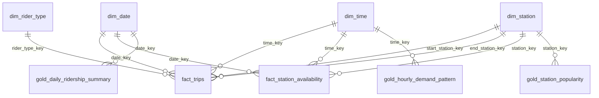

---

# Phase 3 — Gold Layer, Automation & BI

## Architecture

```
 laptop                       Databricks Free Edition (serverless, Unity Catalog `workspace`)                         Power BI
 fetch_samples.py  trips/   ─▶ bronze_trips ──────────────▶ silver_trips ─┬─▶ silver_stations ─┐
 fetch_station_info.py      ─▶ bronze_gbfs_station_info ──▶ silver_gbfs_station_info ──────────┼─▶ GOLD star schema ──▶ dashboard
 poll_gbfs.py      gbfs/    ─▶ bronze_gbfs_station_status ─▶ silver_gbfs_station_status ────────┘   (citibike_gold)
                              quarantine_records  ·  pipeline_execution_logs (every step, every layer) ───────────────▶ pipeline-health page
```

| Notebook | Purpose |
|---|---|
| `notebooks/06_station_info_to_silver.py` | GBFS `station_information` → Bronze → Silver (the id bridge between trips and live availability) |
| `notebooks/07_silver_to_gold_trips.py` | Dimensions, `fact_trips`, and the three aggregate tables |
| `notebooks/08_silver_to_gold_gbfs.py` | `fact_station_availability` (hourly live snapshots) |
| `notebooks/09_optimize_gold.py` | `OPTIMIZE` with liquid clustering; file-count evidence logged |
| `notebooks/10_run_pipeline.py` | One-click end-to-end run (Raw → Gold) with a shared `batch_id` |
| `jobs/citibike_pipeline_job.json` | The same pipeline as an 8-task Databricks Job |
| `scripts/fetch_station_info.py` | Downloads `station_information` as a dated CSV |

## Gold data model — star schema (`workspace.citibike_gold`)



**Surrogate keys** are deterministic: `station_key = xxhash64(station natural id)`, `rider_type_key = xxhash64(member_casual, rideable_type)`,
`date_key = yyyymmdd`, `time_key = hour`. The same entity always gets the same key, on every run, re-run and backfill, so
facts are built without joining to the dimensions and the Gold layer stays idempotent. Key `-1` is the *Unknown station*
member (trips that have coordinates but no station id), so no fact row is ever orphaned.

### `dim_station` — PK `station_key` · ~2,200 rows
| Column | Type | Description |
|---|---|---|
| station_key | BIGINT | Surrogate key (`-1` = Unknown station) |
| station_id | STRING | Natural key: trip-file id (`5989.02`); GBFS id for stations seen only in the live feed |
| station_name | STRING | Official name from `station_information`, else the name seen in trips |
| latitude, longitude | DOUBLE | Official dock location, else the average of trip coordinates |
| gbfs_station_id | STRING | Live-feed id (UUID / 19-digit); links `fact_station_availability` |
| capacity | INT | Number of docks (from `station_information`) |
| has_trip_history, has_live_feed | BOOLEAN | Which sources know this station |

### `dim_date` — PK `date_key` · whole calendar years covering all trips and polls
`date_key INT (yyyymmdd), full_date DATE, year, quarter, quarter_label ('Q1'), month, month_name, month_short, year_month ('2026-03'), year_month_key INT (202603), day_of_month, day_of_week (1=Sun…7=Sat), day_of_week_mon (1=Mon…7=Sun, for sorting), day_name, day_short, is_weekend, week_of_year, season`.

### `dim_time` — PK `time_key` · 24 rows
`time_key INT (0-23), hour_label ('08:00'), hour_12_label ('8 AM'), time_of_day (Morning 6-10, Midday 11-15, Evening 16-20, Night 21-5), time_of_day_sort, is_commute_peak (7-9, 17-19)`.

### `dim_rider_type` — PK `rider_type_key` · 4 rows (junk dimension)
`rider_type_key BIGINT, member_casual, rideable_type, member_label ('Member'), bike_label ('Electric'), rider_type_label ('Member · Electric')`.

### `fact_trips` — PK `ride_id` · grain: one validated trip · `CLUSTER BY (date_key, start_station_key)`
| Column | Type | Description |
|---|---|---|
| ride_id | STRING | Degenerate dimension (trip id) |
| date_key, time_key | INT | FK → `dim_date`, `dim_time` (trip start, New York time) |
| start_station_key, end_station_key | BIGINT | FK → `dim_station` (role-playing) |
| rider_type_key | BIGINT | FK → `dim_rider_type` |
| started_at, ended_at | TIMESTAMP | Trip start / end |
| trip_duration_seconds | BIGINT | Measure |
| trip_duration_minutes | DOUBLE | Measure |
| distance_km | DOUBLE | Straight-line (haversine) distance; NULL if coordinates missing |
| is_round_trip | BOOLEAN | Started and ended at the same station |
| source_month | STRING | Lineage (`YYYYMM` file the trip came from) |

### `fact_station_availability` — PK (`gbfs_station_id`, `poll_timestamp`) · grain: one installed station per hourly poll · `CLUSTER BY (date_key, station_key)`
`gbfs_station_id, poll_timestamp (UTC), poll_timestamp_local (New York), station_key FK, date_key FK, time_key FK, bikes_available, ebikes_available, classic_bikes_available, docks_available, capacity, fill_ratio (bikes ÷ capacity), is_empty, is_full, is_renting, is_returning, last_reported_ts`.

### Aggregate tables (built from `fact_trips`)
| Table | Grain / PK | Main columns | Refresh |
|---|---|---|---|
| `gold_daily_ridership_summary` | `date_key` | total, member, casual, classic, electric and round trips; avg & median minutes; distance; member_share | `replaceWhere` on the affected date range |
| `gold_station_popularity` | (`year_month_key`, `station_key`) | departures, arrivals, `net_flow` (departures − arrivals; > 0 = station drains bikes), member/casual departures, `activity_rank` | `replaceWhere` on the affected months |
| `gold_hourly_demand_pattern` | (`day_of_week`, `time_key`) | total/member/casual trips, `days_observed`, `avg_trips_per_day` | full overwrite (168 rows) |

Every Gold table also has `batch_id` and `load_timestamp`; merged tables have `row_hash`.

## How Gold stays in sync (automation)

| Table type | Strategy | Idempotency |
|---|---|---|
| Dimensions | Rebuilt from Silver, `MERGE` on the surrogate key, update only when `row_hash` changed | Re-run → 0 inserted / 0 updated |
| `fact_trips` | `MERGE` on `ride_id`, one month at a time (same month widgets as notebook 03) | Re-run → 0 inserted / 0 updated |
| `fact_station_availability` | `MERGE` on (`gbfs_station_id`, `poll_timestamp`), one poll-date at a time | Re-run → 0 inserted / 0 updated |
| Aggregates | Recompute the affected range from `fact_trips`, then atomic `replaceWhere` | Range is replaced, never appended |

Every Gold step is logged in `pipeline_execution_logs` with `pipeline_layer = 'silver_to_gold'`: `rows_read` = Silver/fact
rows aggregated, `rows_inserted` / `rows_updated` = Gold rows written, plus `start_time`, `end_time`, `duration_seconds`, `status`.
`OPTIMIZE` runs are logged as `gold_maintenance`.

## Execution guide (Phase 3)

**One-time upgrade of the Phase 2 workspace**
1. Import the new and updated notebooks into the same workspace folder (replace `00_setup`, `01_common`, `99_validation`).
2. Run `00_setup` — it only adds the new schema and tables; existing tables are untouched.
3. On a laptop: `python scripts/fetch_station_info.py`, then upload the CSV to `landing/station_info/`.

**Full build of Gold from existing Silver (first time / backfill)** — run `10_run_pipeline` with
`load_type=full`, `start_month=202603`, `end_month=202608` (your loaded range), `run_station_info=true`, `run_gbfs=true`.
Or run notebooks `06`, `07` (month range), `08` (blank dates = everything), `09` individually.

**Standard incremental run** (new month published / new GBFS file uploaded) — run `10_run_pipeline` with
`load_type=incremental`, `start_month=end_month=<new month>`. Raw → Bronze → Silver → Gold → OPTIMIZE all run in one go.

**Scheduled Job** — Workflows → Jobs → Create → ⋮ → *Edit as JSON*, paste `jobs/citibike_pipeline_job.json`
(replace `<your-email>` in the notebook paths). The schedule is created **paused**; un-pause it only for the demo, to save credits.

**Proving it works** — run `99_validation`: sections 7-12 show Gold row counts, Silver ↔ Gold reconciliation (all diffs 0),
referential integrity (0 orphans), key uniqueness, station-mapping coverage and the Silver-to-Gold audit entries.
Run `07` twice for the same month: the second run logs `rows_inserted = 0`, `rows_updated = 0` for `fact_trips`.
